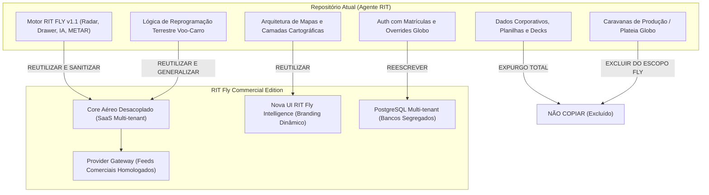

# INVENTÁRIO E PLANO DE SEGREGAÇÃO COMERCIAL: RIT FLY COMMERCIAL EDITION

> **Documento:** Inventário Técnico de Segregação, Propriedade Intelectual e Arquitetura do Produto Comercial  
> **Produto Comercial Provisório:** **RIT Fly Intelligence** (*Central Inteligente de Mobilidade Aérea e Terrestre*)  
> **Produto Corporativo:** **Agente RIT** (*Ambiente corporativo TV Globo / CSC Transportes*)  
> **Commit Técnico de Referência:** `2aa5c7cb172778da512bc0b78c949679659b8be8` (RIT FLY v1.1 Homologado)  
> **Data:** 14 de Outubro de 2026  
> **Status:** Minuta Técnica Preliminar — Segregação e Planejamento (Sem Publicação Externa)

---

## 1. OBJETIVO E DIRETRIZES FUNDAMENTAIS

O objetivo desta auditoria é planejar a evolução do **RIT FLY** para uma solução comercial independente, escalável e 100% segregada da infraestrutura, dados, marca e governança da TV Globo.

### Diretrizes Mandatórias:
1. **Segregação Total de Ambientes:** O produto comercial nascerá em repositório Git, organização, infraestrutura de nuvem, banco de dados, domínio e conta de hospedagem completamente autônomos.
2. **Exclusão de Dados Corporativos e Pessoais:** Nenhuma planilha corporativa, lista de colaboradores, matrícula, dados de passageiros, e-mails internos ou logotipos institucionais da Globo será transposta para o produto comercial.
3. **Limpeza do Banco e Secrets:** O repositório comercial inicia com banco vazio, migrations limpas e apenas `.env.example` (sem segredos ou conexões ativas herdadas).
4. **Governança de Licenciamento de Dados:** Reconhecimento expresso de que a API gratuita do **OpenSky Network** é licenciada estritamente para fins acadêmicos e não comerciais. A edição comercial operará sob arquitetura desacoplada de *Data Providers*, pronta para ingestão de feeds comerciais contratados (ex.: Cirium, FlightAware, Aviationstack, AeroDataBox).
5. **Preservação do Módulo Corporativo:** O módulo corporativo existente permanece em baseline homologado, inalterado e estritamente bloqueado.

---

## 2. INVENTÁRIO DETALHADO DO REPOSITÓRIO ATUAL

Auditoria completa de referências corporativas, identificadores, caminhos e ativos:

| # | Arquivo | Linha / Componente | Tipo de Referência | Classificação de Risco | Ação Recomendada | Resultado Pós-Segregação |
|---|---|---|---|:---:|---|---|
| **01** | `Normas/Base de Colaboradores Globo para validação...xlsx` | Arquivo completo | Dados pessoais reais de colaboradores, matrículas e lotações | 🔴 **CRÍTICO (LGPD / Sigilo)** | **REMOVER** (Expurgo compulsório total) | Excluído do repositório comercial. Não comporá histórico. |
| **02** | `Planilhas de Importação/Relatório Mapa - Solicitante...xlsx` | Arquivo completo | Viagens reais, centros de custo, dados de frotas e solicitantes | 🔴 **CRÍTICO (LGPD / Sigilo)** | **REMOVER** (Expurgo compulsório total) | Excluído do repositório comercial. |
| **03** | `Planilhas de Importação/Planilha de Simulação de Custos de UBER.xlsx` | Arquivo completo | Métricas internas de negociação e custos corporativos | 🟠 **ALTO (Comercial)** | **REMOVER** | Excluído do repositório comercial. |
| **04** | `server/auth.js` | L79, L194, L410, L664, L693 | Matrícula corporativa fixa, e-mail de colaborador, domínios corporativos | 🔴 **CRÍTICO (Segurança / LGPD)** | **REMOVER / SUBSTITUIR** | Substituído por RBAC padrão via banco com tabela `users` e `tenants`. |
| **05** | `server/tenant-config.js` | L9-L29 | Tenant padrão corporativo, unidades operacionais corporativas | 🟠 **ALTO (Marca)** | **SUBSTITUIR** | Multi-tenant genérico (`demo_tenant`, `tenant_id` dinâmico UUID). |
| **06** | `server/geocode.js` | L20-L24, L41-L45 | Hubs fixos corporativos da emissora | 🟡 **MÉDIO (Operacional)** | **SUBSTITUIR** | Hubs configuráveis dinamicamente por cada tenant na entidade `tenant_destinations`. |
| **07** | `server/database.js` | L120-L150 | Seed padrão injetando tenant corporativo e destinos da emissora | 🟠 **ALTO (Marca / Config)** | **SUBSTITUIR** | Seeds genéricos para homologação B2B (`enterprise_demo`). |
| **08** | `server/server.js` | L98-L100, L149-L165 | Domínios Render legados/corporativos | 🟠 **ALTO (Infraestrutura)** | **SUBSTITUIR** | Variáveis de ambiente dinâmicas (`ALLOWED_ORIGINS`, `API_PUBLIC_URL`). |
| **09** | `server/rit-fly/engine/logistics-sync-engine.js` | L17-L45 | Menções a rotas aeroportuárias para sedes corporativas | 🟡 **MÉDIO (Contexto)** | **SUBSTITUIR** | Algoritmo genérico de roteirização aeroporto ➔ endereço corporativo do cliente. |
| **10** | `server/rit-fly/engine/rit-fly-ai.js` | L180-L215 | Prompts mencionando produções televisivas e jornalismo corporativo | 🟡 **MÉDIO (Prompt IA)** | **SUBSTITUIR** | Prompts de IA focados em Inteligência Aérea e Logística Executiva B2B neutra. |
| **11** | `server/rit-fly/store/flight-store.js` | L40-L65 | Viagens de exemplo com prefixo corporativo de produção | 🟡 **MÉDIO (Fixture)** | **SUBSTITUIR** | Fixtures B2B neutras: `TRANSFER_EXEC_001`, `DIRETORIA_REG_02`. |
| **12** | `server/data/cameras_georreferenciadas.json` | 50 registros de câmeras | Nomes de câmeras municipais contendo referência à sede corporativa | 🟢 **BAIXO (Dado Público)** | **ANONIMIZAR / SUBSTITUIR** | Nomes sanitizados para o logradouro público oficial (CET-Rio / Prefeitura). |
| **13** | `public/index.html` | L20-L45 | Logotipos, marca institucional corporativa, Centro de Comando | 🟠 **ALTO (Propriedade Intelectual)** | **SUBSTITUIR** | Interface neutra B2B: **RIT Fly Intelligence** com tema escuro corporativo neutro. |
| **14** | `public/dashboard.html` | L21-L27, L1880 | Logotipo institucional, cabeçalho regional corporativo | 🟠 **ALTO (Propriedade Intelectual)** | **SUBSTITUIR** | Layout neutro SaaS multitenant com branding carregado dinamicamente via `config/branding.js`. |
| **15** | `public/apresentacao.html` | Slides 1 a 12 | Apresentação institucional da emissora, cases internos e eventos | 🔴 **CRÍTICO (Sigilo / PI)** | **REMOVER** | Não fará parte do repositório comercial. Deck comercial próprio a ser elaborado. |
| **16** | `public/caravanas.html` & `CentroRoteirizacaoCustos.js` | Módulos inteiros | Fluxos específicos de vans de plateia e estúdios da emissora | 🟠 **ALTO (Escopo)** | **REMOVER DO CORE FLY** | O RIT Fly comercial focará exclusivamente em Voo + Transporte Executivo B2B. |
| **17** | `Dossier_Registro_Agente_RIT/` & `*.docx` | Documentos em raiz | Declarações de autoria e documentos de depósito | 🔵 **JURÍDICO (Propriedade)** | **PENDENTE DE AUTORIZAÇÃO / ARQUIVAR** | Não versionar no produto comercial; manter em custódia legal do autor. |
| **18** | `.env` | Raiz | Senhas reais de banco local, chaves de teste | 🔴 **CRÍTICO (Segurança)** | **NÃO COPIAR (.gitignore)** | Fornecer exclusivamente `.env.example` sem valores preenchidos. |
| **19** | `server/rit-fly/providers/opensky-provider.js` | L1-L250 | Integração direta com OpenSky gratuito (licença não comercial) | 🟠 **ALTO (Licenciamento)** | **PARAMETRIZAR / ADAPTAR** | Adicionar feature flag `OPENSKY_COMMERCIAL_ENABLED=false` e interface para feeds comerciais. |

---

## 3. MATRIZ DE SEGREGAÇÃO DOS COMPONENTES

Classificação formal de todos os componentes do repositório atual para migração ao produto comercial:



### Classificação Sumária:
- **REMOVER (Expurgo Imediato):** Todas as planilhas da pasta `Normas/`, arquivos de simulação Uber, apresentações PPTX e HTML corporativas (`apresentacao.html`), documentos cadastrais pessoais, scripts de scraping e referências a Projac/Curicica.
- **SUBSTITUIR (Reescrita / Parametrização):** Sistema de autenticação (`auth.js`), catálogo de tenants (`tenant-config.js`), geocodificador (`geocode.js`), cabeçalhos de tela (`topbar`), prompts de inteligência artificial (`rit-fly-ai.js`).
- **ANONIMIZAR:** Nomes de câmeras públicas que citavam a sede corporativa; identificadores de voos e motoristas de teste.
- **PENDENTE DE AUTORIZAÇÃO / REVISÃO:** Titularidade do código perante o empregador anterior vs autor independente (ver Análise Jurídica na Seção 4).
- **POTENCIALMENTE REUTILIZÁVEL, SUJEITO À VALIDAÇÃO DE TITULARIDADE:**
  - Motor de radar aéreo Leaflet com rotação de proa vetorial SVG (`rit-fly-map.js`) — especificação algorítmica e conceitos matemáticos neutros;
  - Algoritmo de projeção de tempo e distância Haversine (`flight-dto.js`) — fórmula matemática de domínio público;
  - Parser e decodificador aeronáutico de METAR (`metar-provider.js`) — padrão aeronáutico público da OACI/WMO;
  - Drawer lateral responsivo estilo FlightRadar24 (`rit-fly-view.js`) — especificação de interface e UX neutra;
  - Chatbot conversacional com árvore de intenções logísticas (`rit-fly-ai.js`) — arquitetura de intenções a ser reescrita sem vocabulário corporativo;
  - Seletor de camadas cartográficas sem recarga de página — implementação baseada em especificações abertas Leaflet/OSM.

---

## 4. ANÁLISE DE PROPRIEDADE INTELECTUAL E LICENÇAS PENDENTES

### 4.1 Titularidade do Código e Vínculo Corporativo
- **Constatação:** O repositório atual encontra-se no diretório `OneDrive - Globo Comunicação e Participações sa`, e commits históricos contêm autoria com e-mail corporativo.
- **Anterioridade INPI:** O autor Fábio Paixão possui depósito de registro perante o INPI em 06/10/2026 com código SHA-256 e declaração de autoria pessoal via GOV.BR, sob o domínio `agenterit.com.br`.
- **Risco Jurídico:** A legislação brasileira de propriedade de software (Lei nº 9.609/1998, Art. 4º) prevê que pertencem ao empregador os direitos relativos ao programa de computador desenvolvido durante a vigência de contrato de trabalho expressamente destinado a esse fim ou que utilize recursos, informações tecnológicas ou segredos da empresa.
- **Recomendação Estrita:** Antes de qualquer comercialização ou captação de clientes externos, é indispensável obter **anuência formal, termo de cessão ou declaração de não-conflito / liberação de titularidade** firmada pelo departamento jurídico corporativo, garantindo a plena independência do código da versão comercial.

### 4.2 Licenciamento do OpenSky Network
- **Cláusula de Uso Não Comercial:** O acesso gratuito à API REST do OpenSky (`https://opensky-api.org`) é regido pelos termos de pesquisa acadêmica e uso pessoal/não comercial.
- **Limitação de Dados:** O OpenSky não fornece:
  - Grade programada de voos comerciais;
  - Status oficiais de cancelamento de companhias;
  - Portões de embarque ou esteiras de bagagem;
  - Informações de plano de voo IFR de rotas comerciais fechadas.
- **Decisão Arquitetural:** O produto comercial terá uma flag `OPENSKY_COMMERCIAL_ENABLED=false` por padrão. Para operação comercial real, o sistema utilizará um adaptador neutro preparado para conexão com provedores B2B licenciados.

### 4.3 Licenciamento de Mapas e Basemaps
- **OpenStreetMap (OSM):** Requer atribuição obrigatória `© OpenStreetMap contributors` (ODbL). Permitido uso comercial com atribuição.
- **CartoDB Voyager / DarkMatter:** Gratuito sob limites razoáveis com atribuição obrigatória `© CARTO`.
- **Esri World Imagery:** Sujeito aos termos de serviço da Esri para aplicações web com atribuição. Para produção de grande escala, recomenda-se a contratação de Mapbox, MapTiler ou Google Maps Platform corporativo.

---

## 5. ARQUITETURA COMERCIAL PROPOSTA

A edição comercial (**RIT Fly Intelligence**) adota arquitetura moderna, desacoplada e 100% multitenant:

```
[ Usuários Web / Mobile B2B ]
              │
      HTTPS / TLS 1.3
              ▼
   [ Cloudflare WAF + CDN ]
              │
              ▼
    [ API Gateway / NGINX ]
   (Rate Limiting, CORS, CSP)
              │
    ┌─────────┴─────────┐
    │                   │
    ▼                   ▼
[ Frontend SPA ]    [ Backend REST API (Node.js/Express) ]
(RIT Fly Core)      ├── Middleware de Autenticação JWT / RBAC
                    ├── Tenant Context Resolver (x-tenant-id / JWT)
                    ├── Flight Tracking Service
                    ├── Airport Intelligence Service
                    ├── Ground Mobility Sync Engine
                    ├── Operational Alert Engine
                    └── Contextual AI Engine (RIT Fly AI)
                                │
    ┌───────────────────────────┼───────────────────────────┐
    │                           │                           │
    ▼                           ▼                           ▼
[ Provider Gateway ]    [ PostgreSQL Segregado ]    [ Redis Cache & Fila ]
├── FlightAware API     ├── Schema por Tenant       ├── Cache de Telemetria
├── Cirium / AviationStack    (ou Row-Level Security) ├── Rate Limiting
├── NOAA METAR Service  ├── Entidades Operacionais  └── Deduplicação de Alertas
└── Geocoding/Routing   └── Auditoria LGPD
```

---

## 6. MODELO CANÔNICO DE DADOS COMERCIAL

O modelo de dados comercial elimina qualquer campo informal ou proprietário e estabelece rastreabilidade estrita da proveniência do dado:

### 6.1 Tabela Principal: `flights` (Canônica)
```sql
CREATE TABLE flights (
    id UUID PRIMARY KEY DEFAULT gen_random_uuid(),
    tenant_id UUID NOT NULL REFERENCES tenants(id) ON DELETE CASCADE,
    provider_name VARCHAR(50) NOT NULL,
    provider_flight_id VARCHAR(100),
    flight_number VARCHAR(20) NOT NULL,
    callsign VARCHAR(20),
    aircraft_registration VARCHAR(20),
    aircraft_type VARCHAR(50),
    airline_iata VARCHAR(3),
    airline_icao VARCHAR(4),
    airline_name VARCHAR(100),
    departure_airport_iata VARCHAR(3) NOT NULL,
    departure_airport_icao VARCHAR(4),
    arrival_airport_iata VARCHAR(3) NOT NULL,
    arrival_airport_icao VARCHAR(4),
    scheduled_departure TIMESTAMPTZ,
    estimated_departure_provider TIMESTAMPTZ,
    actual_departure TIMESTAMPTZ,
    scheduled_arrival TIMESTAMPTZ,
    estimated_arrival_provider TIMESTAMPTZ,
    estimated_arrival_rit TIMESTAMPTZ,
    actual_landing TIMESTAMPTZ,
    actual_gate_arrival TIMESTAMPTZ,
    flight_status VARCHAR(30) NOT NULL DEFAULT 'SCHEDULED',
    latitude DOUBLE PRECISION,
    longitude DOUBLE PRECISION,
    barometric_altitude DOUBLE PRECISION,
    geometric_altitude DOUBLE PRECISION,
    ground_speed DOUBLE PRECISION,
    vertical_rate DOUBLE PRECISION,
    heading DOUBLE PRECISION,
    on_ground BOOLEAN DEFAULT FALSE,
    data_mode VARCHAR(30) NOT NULL CHECK (data_mode IN ('LIVE_PROVIDER', 'CACHED_PROVIDER', 'CALCULATED_RIT', 'INFERRED', 'SYNTHETIC', 'UNAVAILABLE')),
    confidence_score NUMERIC(3, 2) DEFAULT 1.00,
    last_provider_update TIMESTAMPTZ,
    last_calculated_at TIMESTAMPTZ,
    created_at TIMESTAMPTZ DEFAULT NOW(),
    updated_at TIMESTAMPTZ DEFAULT NOW()
);

CREATE INDEX idx_flights_tenant ON flights(tenant_id);
CREATE INDEX idx_flights_number ON flights(flight_number);
CREATE INDEX idx_flights_airports ON flights(departure_airport_iata, arrival_airport_iata);
CREATE INDEX idx_flights_status ON flights(flight_status);
```

### 6.2 Entidades de Integração Voo ➔ Transporte Terrestre: `ground_transfers`
```sql
CREATE TABLE ground_transfers (
    id UUID PRIMARY KEY DEFAULT gen_random_uuid(),
    tenant_id UUID NOT NULL REFERENCES tenants(id) ON DELETE CASCADE,
    flight_id UUID REFERENCES flights(id),
    passenger_anonymized_id VARCHAR(100) NOT NULL,
    transfer_type VARCHAR(30) NOT NULL CHECK (transfer_type IN ('AIRPORT_PICKUP', 'AIRPORT_DROPOFF')),
    origin_address TEXT NOT NULL,
    destination_address TEXT NOT NULL,
    driver_anonymized_id VARCHAR(100),
    vehicle_plate_masked VARCHAR(20),
    original_pickup_time TIMESTAMPTZ NOT NULL,
    suggested_pickup_time TIMESTAMPTZ NOT NULL,
    status VARCHAR(30) NOT NULL DEFAULT 'PLANNED',
    created_at TIMESTAMPTZ DEFAULT NOW(),
    updated_at TIMESTAMPTZ DEFAULT NOW()
);
```

---

## 7. ESTRATÉGIA DE MULTITENANCY E RBAC

1. **Isolamento de Dados no Banco:**
   - Opção 1: **Row-Level Security (RLS)** nativo no PostgreSQL garantindo que nenhuma consulta sem `tenant_id` válido acesse dados de outra organização;
   - Opção 2: **Schemas Segregados** (`tenant_xyz.flights`) para clientes Enterprise de grande porte.
2. **Autorização Rígida no Backend (RBAC):**
   - Perfis:
     - `SUPER_ADMIN`: Gestão global da plataforma e monitoramento de saúde;
     - `TENANT_ADMIN`: Gestão de usuários, configurações e políticas de alerta da sua empresa;
     - `OPERADOR`: Acompanhamento operacional, vinculação de transportes e aceitação de reprogramações;
     - `ANALISTA`: Emissão de relatórios e auditoria de SLAs logísticos;
     - `VISUALIZADOR`: Apenas leitura de mapa e voos monitorados;
     - `AUDITOR`: Acesso a logs de auditoria e trilha LGPD.
3. **Impossibilidade de Escalação de Privilégios:** O contexto do tenant é validado criptograficamente no token JWT assinado no backend, impedindo adulteração de headers HTTP.

---

## 8. CATÁLOGO DE PROVEDORES DE DADOS PARA AVALIAÇÃO COMERCIAL

| Provedor | Tipo de Serviço | Licença Comercial | Custos Estimados | Cobertura | Status de Homologação |
|---|---|---|---|---|:---:|
| **FlightAware (Firehose/AeroAPI)** | ADS-B, Grade e Atrasos | Comercial Dedicada | Pay-as-you-go / Mensal | Global (Alta densidade Brasil) | **Candidato Preferencial** |
| **Cirium (FlightStats APIs)** | Grade oficial e status | Comercial Enterprise | Contrato anual | Global / Todas as Cias | **Candidato Preferencial** |
| **Aviationstack** | Grade e dados de voo | Planos Business/Enterprise | $49 a $499/mês | Global | **Candidato Intermediário** |
| **AeroDataBox (RapidAPI)** | ADS-B e Aeroportos | Comercial via RapidAPI | Freemium / Pay-per-call | Global | **Candidato para Testes** |
| **NOAA Aviation Weather (AWC)** | METAR, TAF, SIGMET | Domínio Público Internacional | Gratuito | Global / Aeródromos ICAO | ✅ **Homologado na v1.1** |
| **OpenSky Network** | ADS-B Comunitário | **Acadêmica / Não-Comercial** | Comercial requer termo | Brasil / Global | ⚠️ **Desativado na Edição Comercial** |

---

## 9. VERIFICADOR AUTOMÁTICO DE SEGREGAÇÃO (CI/CD GATE)

Para garantir que nenhum artefato ou menção corporativa entre no repositório comercial, será incluído no pipeline o script `scripts/verify-commercial-segregation.js`.

### Regras de Bloqueio Automático do Build:
- Busca recursiva por palavras proibidas: `globo`, `projac`, `curicica`, `tvglobocorp`, `fapaixao`, `fabiopaixao`, `68808`;
- Busca por links do SharePoint corporativo;
- Busca por chaves privadas, arquivos `.env` ou dumps de banco;
- Busca por extensões proibidas: `.xlsx`, `.pptx`, `.docx` na pasta de código;
- O build de homologação comercial **falhará automaticamente** com exit code 1 caso qualquer uma dessas strings seja detectada.

---

## 10. ROADMAP EM 10 CHECKPOINTS PARA A SEGREGAÇÃO COMERCIAL


- **Checkpoint 1:** Inventário finalizado, matriz de expurgo aprovada, criação do `.env.example` comercial limpo;
- **Checkpoint 2:** Criação de `config/branding.js`, eliminação de logotipos corporativos, nova paleta visual neutra;
- **Checkpoint 3:** Implementação de `tenants`, `users`, `roles`, middleware JWT e isolamento PostgreSQL;
- **Checkpoint 4:** Arquitetura de `ProviderGateway`, modelo canônico com `data_mode` estrito, OpenSky comercial desativado por flag;
- **Checkpoint 5:** Mapa e quadro de voos operando exclusivamente com dados canônicos neutros e indicação de proveniência;
- **Checkpoint 6:** Motor de integração aéreo-terrestre B2B para transporte executivo com dados anonimizados;
- **Checkpoint 7:** RIT Fly AI com árvore de intenções livre de contexto de produção televisiva;
- **Checkpoint 8:** Circuit breaker, timeout, rate limiting, logging sanitizado e correlation ID;
- **Checkpoint 9:** Suíte de testes automatizados com Playwright, verificador de segregação e minutas técnicas de Termos de Uso/LGPD;
- **Checkpoint 10:** Auditoria final de conformidade para homologação externa e preparação do repositório limpo.

---

## 11. PLANO DE TESTES E PLANO DE ROLLBACK COMERCIAL

### 11.1 Estratégia de Testes Segregada:
- **Testes Unitários e de Contrato:** Executados contra interfaces genéricas com injeção de dependência;
- **Testes de Resiliência:** Simulação forçada de quedas de provedores externos (429, 500, timeout), garantindo que o sistema exiba `"Dado temporariamente indisponível"` sem travar e sem gerar dados falsos;
- **Testes de Isolamento Multi-tenant:** Testes automatizados que tentam acessar recursos do Tenant A autenticado com credenciais do Tenant B, exigindo status HTTP 403 / 404;
- **Testes de Segregação Estática:** Varredura obrigatória no CI com zero falsos negativos.

### 11.2 Plano de Rollback:
- Versionamento imutável de imagens Docker do backend comercial;
- Migrations de banco de dados estritamente reversíveis (`up` e `down` testados em staging);
- Chave de feature flag para desligamento imediato de qualquer provider com comportamento anômalo.

---

## 12. PARECER CONCLUSIVO E DECISÃO

- **Testado em ambiente real:** Sim (no escopo técnico do commit baseline `2aa5c7c` em ambiente local homologado)
- **Ambiente utilizado:** Localhost / PostgreSQL / Chromium Playwright
- **Dependências externas:** Provedores de dados aéreos comerciais com SLA (pendentes de contratação contratual)
- **Pendências jurídicas:** Validação formal da titularidade do código e autorização expressa de exploração comercial independente
- **Pendências de licenciamento:** Substituição do OpenSky por feed B2B com licença comercial e SLA
- **Classificação de Riscos Residuais:**
  - **Risco Residual Técnico:** **Médio** (arquitetura desacoplada e validada localmente, mas carece de integração com provedores B2B finais e testes sob carga real)
  - **Risco de Segregação:** **Alto** (enquanto o desenvolvimento ocorrer no mesmo host/repositório corporativo; atenuado para Baixo somente com workspace limpo e auditoria estática aprovada)
  - **Risco Jurídico / Titularidade:** **Alto** (permanece alto até que haja manifestação formal do jurídico corporativo autorizando a exploração ou cessão de direitos)
  - **Risco de Licenciamento de Dados:** **Alto** (OpenSky é estritamente não-comercial; o produto comercial não pode ser comercializado sem contrato com FlightAware, Cirium, AeroDataBox ou equivalente)
- **Decisão para Planejamento em Workspace Segregado:** 🟢 **GO (Autorizada criação de workspace neutro de planejamento, sem cópia de código)**
- **Decisão para Criação de Repositório Externo:** 🟡 **HOLD (Aguardando homologação da estrutura neutra e parecer de titularidade)**
- **Decisão para Publicação Externa / Produção Comercial:** 🔴 **NO-GO (Estritamente bloqueada até saneamento total das pendências de titularidade e licenciamento)**
